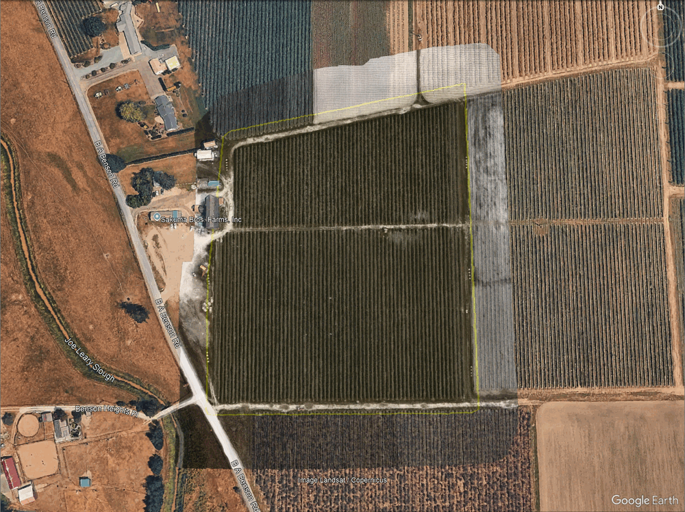

# uav-aoi-subset

[](https://github.com/sirriselimkalac/uav-aoi-subset/actions/workflows/ci.yml)

Split very large drone image datasets (for example multispectral cameras that write one
file per band, 100,000+ images per campaign) into subsets that fall inside an area of
interest (AOI) drawn as a polygon in Google Earth or any GIS (KML/KMZ), so that each subset
can be processed separately in your photogrammetry software.

In short: point it at a project folder (the images can sit at any folder depth) and an AOI
file, and it puts the images that fall inside the AOI into a new sub-folder. With
`--mode hardlink` this takes no extra disk space.

A free, open-source alternative to commercial GIS tools for this one job.

Why this tool exists?

I collect drone data in the field myself, and I've learned that a plan made in the office rarely survives the site in full. By the time the photos are uploaded to the server, I sometimes wish I had flown or organised things differently. So I wrote a few small tools to make life easier. When you change your mind, or need a quick answer for just part of a large dataset, you need a subset of what you already have. This tool makes that subset for you.

> **Status: alpha.** Automated tests run on Windows, macOS and Linux. Before you use it on your
> own data, you can try it on a public dataset the way we tested it (see
> [Example dataset](#example-dataset)).

## Where it fits

```
raw captures  →  AOI subset (this tool)  →  photogrammetry  →  ML tiling
```

## How it works

1. **index**: scan a flight folder tree at any depth, group the per-band files
   (`IMG_0000_1.tif … IMG_0000_7.tif`) into captures, check that every band is present and
   read the capture position from the GPS tags of band 1. A capture is identified by its
   folder *and* image number, because some cameras restart numbering in every
   `####SET` folder. Use `--exclude 'Calibration*'` to skip folders such as
   calibration-panel shots.
2. **filter**: keep the captures that fall inside one or more AOI polygons (KML/KMZ, with
   holes and an optional buffer in metres).
3. **copy**: copy (or hard-link) the band files of the selected captures into one new
   folder next to the project (`<project>_subset_01`, `_02`, …), with one sub-folder per
   source folder named after its folder chain
   (`Part1/0000SET/000/IMG_0000_1.tif` → `Part1_0000SET_000/IMG_0000_1.tif`), and write a
   report. File names are not changed. `--mode hardlink` makes the subset without using extra
   disk space (see [Hard links](#hard-links-subsets-without-extra-disk-space)).
   `--layout flat` puts all files into one folder instead and **renames** them
   (`Part1_0000SET_000_IMG_0000_1.tif`); make sure your software supports renamed files
   before you use it.
4. **footprint**: write the outline of all capture positions as a KML polygon (convex or
   concave, optionally buffered, optionally one polygon per flight folder), which helps when
   you draw the AOIs and can itself be used as an AOI.

## Positional accuracy: what the tool selects by

Read this before you rely on a subset.

**The position used is where the camera was, not what the image shows.** Each capture is
selected by the GNSS position stored in its EXIF tags: the latitude and longitude recorded
when the shutter fired, i.e. the camera's position in the air. It is *not* the ground
position of the image centre, and *not* a corner coordinate as in a world file (`.tfw`).
The altitude tag is not used.

A capture is kept when this single point lies inside the AOI. Because an image covers an
area, and that area is not always centred under the camera, the selected images and the
area you drew never match exactly:

- **Image footprint.** An image covers roughly *flight height × sensor width ÷ focal
  length* across. A camera with an 8 mm lens and a 7.1 mm wide sensor at 100 m above
  ground covers about 89 m × 67 m. Images whose position lies just outside the AOI may
  still show parts of it and are left out; images just inside also show ground outside it.
- **Camera tilt.** If the camera does not point straight down (wind, turns, no gimbal), the
  image centre moves by about *height × tan(tilt)*: around 9 m at 100 m for a 5° tilt.
- **GNSS accuracy.** Standard receivers are accurate to a few metres; RTK/PPK systems to
  centimetres.

**Effect on processed products.** Photogrammetry builds the edges of a mosaic from fewer
overlapping images, so the product made from a subset is usually a little smaller than, or
slightly offset from, the AOI, and its quality drops towards the edges.

**What to do**

- Draw the AOI larger than the area you need, or use `filter --buffer`. As a rule of thumb,
  buffer by at least half the image footprint width, or by one to two flight-line spacings.
- After processing, crop the final product to the exact AOI in your GIS software.
- Use `footprint` and `copy --dry-run` to check the coverage and the capture count before
  copying.

The tool does not compute true image footprints. That would need the camera model, the
camera attitude and a terrain model for every image, which is outside the scope of this
tool.

<!-- AUTHOR (optional): one sentence from your own field experience, e.g. the buffer you use
     in practice and the offset you saw between a subset's mosaic and the AOI. Fill in after
     the real-data validation. -->

## Tested setup and compatibility

<!-- KEEP: this section is the only place where the README names the author's hardware and
     software. It is a deliberate transparency statement; do not remove or neutralise it. -->

The workflow grew out of the author's field work with a **MicaSense Altum-PT**
multispectral camera and **Pix4Dmapper**. The tool itself was tested with the public Altum-PT
example dataset (see [Example dataset](#example-dataset)), a layered copy of it, and synthetic
data.

The code itself is meant to be independent of any camera or software brand, and every
precaution we could think of has been taken to keep it that way:

- the band count and the file-name pattern are parameters (`--bands`, `--pattern`);
- positions are read from the standard EXIF GPS tags with ExifTool;
- areas of interest are standard KML/KMZ polygons;
- the output is plain folders and CSV files that any photogrammetry or GIS software can read;
- file names are not changed by default (`--layout folders`);
- the example-data helper (`examples/make_layered_dataset.py`) takes the same `--bands` and
  `--pattern`, so it works with any one-folder dataset of per-band files.

Other cameras, firmware versions or processing software may still behave in ways we could
not foresee: different file naming or folder layouts, missing or unusual GPS tags, or
import problems in your software. If you run into such a problem, please
[open an issue with the bug report form](https://github.com/sirriselimkalac/uav-aoi-subset/issues/new?template=bug_report.yml); it asks for the
camera and software (with versions), the command you ran and its output, and the output of
`uav-aoi-subset --version`. No imagery is needed. We will do our best to fix it.

Product names are trademarks of their respective owners and are mentioned only to describe
the test setup; this project is not affiliated with or endorsed by them.

## Installation

You need three things: **uv** (it installs a suitable Python, 3.11 or newer, for you),
**ExifTool** (reads the GPS tags) and this tool. No administrator rights are needed on
Windows if you follow the "without admin" routes below.

> **Open a new terminal window after every installation step** (on Windows: close
> PowerShell and open it again). Programs that were just installed or added to `PATH` are
> only found in windows opened afterwards.

### 0. Check what you already have

On Windows, in PowerShell:

```powershell
winget --version
git --version
uv --version
exiftool -ver
```

Each line either prints a version or says the name `is not recognized`. Skip the steps for the
tools you already have. If `winget` is not recognized (it is missing on some Windows Server
versions and on locked-down company computers), use the routes below that do not need it.
Git is optional: step 3 also works with a ZIP download.

### 1. uv

- **Windows** (PowerShell):

  ```powershell
  powershell -ExecutionPolicy ByPass -c "irm https://astral.sh/uv/install.ps1 | iex"
  ```

  If scripts or downloads from PowerShell are blocked (common on company computers), use one
  of these instead:
  - `winget install --id astral-sh.uv -e --source winget`
  - or, if Python is already installed: `py -m pip install --user uv`
  - or, without any installer: download `uv-x86_64-pc-windows-msvc.zip` from the
    [uv releases page](https://github.com/astral-sh/uv/releases), extract `uv.exe` into a folder
    of your own (for example `C:\Tools\uv`) and add that folder to your `PATH` (see
    [Adding a folder to PATH on Windows](#adding-a-folder-to-path-on-windows)).
- **macOS / Linux**: `curl -LsSf https://astral.sh/uv/install.sh | sh` (or `brew install uv`).

Close the window, open a new one and check: `uv --version`. In the window you installed from,
`uv` is usually not found yet.

### 2. ExifTool

- **Windows**, one of:
  - `winget install --id OliverBetz.ExifTool -e --source winget` (installs for your user,
    under `AppData\Local\Programs`, and puts ExifTool on `PATH`);
  - the Windows installer linked from [exiftool.org](https://exiftool.org/);
  - **without an installer:** download the Windows executable ZIP from
    [exiftool.org](https://exiftool.org/) and extract it to a folder of your own, for example
    `C:\Tools\exiftool`. Rename `exiftool(-k).exe` to **`exiftool.exe`** (with the `(-k)` in
    the name ExifTool waits for a key press and the tool would hang) and keep the
    `exiftool_files` folder next to it. Then either add `C:\Tools\exiftool` to your `PATH`, or
    skip that and give the full path when indexing:
    `uav-aoi-subset index ROOT --exiftool C:\Tools\exiftool\exiftool.exe`.
  - `choco install exiftool` also works but needs an administrator PowerShell.
- **macOS**: `brew install exiftool`, or the macOS package from [exiftool.org](https://exiftool.org/).
- **Debian/Ubuntu**: `sudo apt install libimage-exiftool-perl`; **Fedora**:
  `sudo dnf install perl-Image-ExifTool`.

Check in a new window: `exiftool -ver`

### 3. This tool

With Git. If `git --version` was not recognized in step 0, install it first or use the ZIP route
below. On Windows: `winget install --id Git.Git -e --source winget`, or the installer from
[git-scm.com](https://git-scm.com/download/win); then open a new window.

```bash
git clone https://github.com/sirriselimkalac/uav-aoi-subset.git
cd uav-aoi-subset
uv sync
uv run uav-aoi-subset --version
```

**Without Git:** on the [repository page](https://github.com/sirriselimkalac/uav-aoi-subset)
choose *Code → Download ZIP*, extract it (for example to `C:\Tools\uav-aoi-subset-main`),
then in PowerShell:

```powershell
cd C:\Tools\uav-aoi-subset-main
uv sync
uv run uav-aoi-subset --version
```

`--version` prints three lines: the tool, Python and the ExifTool it found. If the last line
says ExifTool was not found, see step 2.

`uv run uav-aoi-subset …` works inside this folder. To type `uav-aoi-subset …` in any folder
instead, install it as a command once, then open a new window:

```bash
uv tool install .
uv tool update-shell      # adds uv's command folder to PATH, if needed
```

(After downloading a newer version, run `uv tool install . --reinstall` again.)

### Adding a folder to PATH on Windows

Start menu → type *environment variables* → *Edit environment variables for your account*
(no administrator rights needed) → select *Path* → *Edit* → *New* → paste the folder, for
example `C:\Tools\exiftool` → *OK*. Open a new PowerShell window.

### Troubleshooting the installation

| Message | What to do |
|---|---|
| `git : The term 'git' is not recognized` | Git is not installed: install it (step 3) and open a new window, or use the ZIP route. |
| `winget : The term 'winget' is not recognized` | winget is not available on this computer: use the installer, `pip` or ZIP routes. |
| `uv : The term 'uv' is not recognized` | Open a new PowerShell window. If it persists, uv's folder is not on `PATH`: use another route from step 1. |
| `running scripts is disabled on this system` | Use `winget`, `pip` or the ZIP route of step 1; the tool itself needs no script permission. |
| `ExifTool was not found on PATH` | Install it (step 2) and open a new window, or pass `--exiftool C:\path\to\exiftool.exe`. |
| ExifTool seems to hang | The file is still called `exiftool(-k).exe`; rename it to `exiftool.exe`. |
| Warnings about long paths after `copy` | Choose a shorter `--dest`, for example `D:\subsets\north`. |

## Usage

A typical run, from a flight folder tree to one subset folder per area:

```bash
uav-aoi-subset index     D:\survey                        # D:\survey\survey_image_index_YYYYMMDD.csv
uav-aoi-subset footprint D:\survey\survey_image_index_YYYYMMDD.csv   # outline, helps drawing AOIs
uav-aoi-subset filter    D:\survey\survey_image_index_YYYYMMDD.csv --aoi D:\aoi\north.kml
uav-aoi-subset copy      D:\survey D:\aoi\north_image_index_YYYYMMDD.csv --dry-run
uav-aoi-subset copy      D:\survey D:\aoi\north_image_index_YYYYMMDD.csv    # D:\survey_subset_01
```

(Use `uv run uav-aoi-subset …` inside the tool's folder if you did not install it as a command.)

### Hard links: subsets without extra disk space

```bash
uav-aoi-subset copy D:\survey D:\aoi\north_image_index_YYYYMMDD.csv --mode hardlink
```

A hard link is a second name for the same file on the disk, so the subset folder looks and
works like a normal copy but needs no extra space: the summary shows `Space needed: 0 bytes`.
Keep in mind:

- It only works on the same drive as the project. The tool checks this before it starts and
  stops with a message instead of copying.
- The linked files **share their contents** with the originals. Do not edit them in place
  (for example with a program that rewrites the image files); that would change the original
  too. Reading and processing them is fine.
- Deleting the subset folder later does not delete the originals.
- Without `--mode`, `copy` makes real copies (`--mode copy`), which need as much free space as
  the selected files; the tool checks the free space first.

All commands and options:

```
uav-aoi-subset index     ROOT [--bands 7] [--pattern ...] [--exclude DIR_GLOB ...] [--out CSV]
                         [--exiftool PATH]
uav-aoi-subset filter    INDEX_CSV --aoi AREA.kml|.kmz [--buffer METRES] [--out CSV]
                         [--skip-duplicates]
uav-aoi-subset copy      ROOT SUBSET_CSV [--dest DIR] [--mode copy|hardlink|move]
                         [--layout folders|flat] [--dry-run] [--include FILE_GLOB ...]
                         [--extra-captures ...] [--skip-duplicates]
uav-aoi-subset footprint INDEX_CSV [--out KML] [--hull convex|concave] [--ratio R]
                         [--buffer METRES] [--per-folder [DEPTH]] [--overwrite]
uav-aoi-subset --version
```

Every command also accepts `--no-picker` and `--debug` (see below). `uav-aoi-subset COMMAND
--help` lists all options.

### File and folder pickers

Leave out a required path and a file or folder picker asks for it, for example
`uav-aoi-subset filter` with no arguments. The pickers ask in a fixed order: `filter` asks for
the index CSV and then the AOI file, `copy` for ROOT and then the subset CSV. Each picker
opens in the folder of the path before it. Only the missing paths are asked for. Cancelling a
picker stops the command (exit code 1) without doing anything.

After the pickers, the tool prints the equivalent command line, for example:

```
Equivalent command: uav-aoi-subset filter "D:\survey\survey_image_index_20261028.csv" --aoi "D:\aoi\north.kml"
```

Copy it to repeat the run, or to use it in a script.

Pickers open only when you run the tool yourself in a terminal: they need a display, and
standard input must be a terminal. They never open when the tool runs from a script with
redirected input, from a scheduler or on a server without a display. In those cases a missing
path is a usage error (exit code 2), as in any command-line tool. To switch pickers off
completely, add `--no-picker` or set the environment variable `UAV_AOI_SUBSET_NO_PICKER=1`.

### What index skips, and copies of the same capture

`index` (and `copy`, which looks the captures up again) walks every folder under ROOT except:

- hidden folders (name starting with `.`) and Windows system folders such as
  `$RECYCLE.BIN` and `System Volume Information`;
- output folders written by `copy` (they contain a `.uav-aoi-subset-output` file);
- folders matching `--exclude`;
- linked folders (symbolic links, Windows junctions), which are never followed, so link loops
  cannot make the scan endless;
- folders it is not allowed to read.

The last two are listed under *Folders not scanned* in the summary; the run goes on without
them.

When the same capture is found in more than one folder (same image name, capture time and
position, for example an old subset folder or a backup kept inside ROOT), `index`, `filter`
and `copy` list these copies but keep going. Leave them out with `--exclude <their folder>`,
or with `--skip-duplicates` in `filter` or `copy`, which keeps the first folder of each group
(in alphabetical order) and lists the others.

If ROOT is the top of a drive (`D:\`), there is no folder next to it, so `copy` writes to
`D:\D_subset_01` inside it instead (later `index` runs skip it) and the index CSV is named
`D_image_index_YYYYMMDD.csv`.

### Progress and errors

Long steps (scanning folders, reading GPS tags, copying) show a progress bar with the count,
the percentage and the estimated time left. When the output is redirected to a file, the
tool writes one line per 10 % instead, so logs stay readable.

Every error message says what to do next. Ctrl+C stops the tool cleanly; an interrupted
`copy` removes unfinished files and tells you how to resume. If something unexpected goes
wrong, the tool prints a short message; run the same command again with `--debug` to see the
full details, and please [report it](https://github.com/sirriselimkalac/uav-aoi-subset/issues/new?template=bug_report.yml).

### Exit codes

| Code | Meaning |
|---|---|
| 0 | success |
| 1 | error (the message says what to do next), or a picker was cancelled |
| 2 | usage error: a required argument is missing or an option is invalid |
| 130 | interrupted with Ctrl+C |

### Filter details

`filter` reads every Polygon in the KML/KMZ (also inside folders and multi-geometries),
combines them, and leaves out captures inside polygon holes. Points on the boundary count
as inside. `--buffer 20` grows the area by 20 m (computed in the local UTM zone); a negative
value shrinks it. The output has the same columns as the index CSV and is written next to
the AOI file as `<AOI name>_image_index_YYYYMMDD.csv`.

## Example dataset

Before you run the tool on your own raw data, you can try it the way we tested it:

1. download the public example dataset (below);
2. optionally give it a field-like folder tree with the helper script, so that it looks like
   data straight from the camera;
3. use the ready-made AOI files in [`examples/`](examples/);
4. run the commands below and compare your counts with ours.

The dataset is
[Altum-PT data of a blueberry field](https://eaglenxt.com/data-set/altum-pt-data-of-a-blueberry-field/)
published by EagleNXT: 480 captures × 7 bands, about 19 GB as a ZIP archive and 25 GB
extracted.

The data is not included in or redistributed by this repository. Download it from the
provider's page; its terms of use are set by the provider.



As published, the dataset is **one folder**: all 3,360 band files and a calibration CSV side
by side, with no sub-folders. The tool works with it as it is.

Example files in [`examples/`](examples/):

| File | What it is | Captures inside |
|---|---|---|
| `blueberries.kml` | the outline of the field (the `footprint` of all capture positions) | 480 |
| `area-of-interest.kml` | an AOI of about 1 ha inside the field | 74 |

### The dataset as published

Download and extract the ZIP, for example to `C:\data\blueberry` (the folder that holds the
3,361 files). Then, from the tool's folder (replace `YYYYMMDD` with the date in the file
names):

```bash
uav-aoi-subset index C:\data\blueberry
uav-aoi-subset filter C:\data\blueberry\blueberry_image_index_YYYYMMDD.csv --aoi examples\area-of-interest.kml --out C:\data\aoi_flat.csv
uav-aoi-subset copy C:\data\blueberry C:\data\aoi_flat.csv --mode hardlink
```

- `index`: 480 captures, all complete, all with a GPS position.
- `filter`: 74 captures inside the AOI.
- `copy`: a new folder `C:\data\blueberry_subset_01` with the 518 band files (74 × 7) under
  their original names, `Space needed: 0 bytes`, and a report CSV next to it.

### Why field data is harder

Data straight from the field rarely looks like that:

- Some multispectral cameras open a new numbered set folder (`0000SET`, `0001SET`, …) every
  time they are switched on or start a flight, and **restart the image numbering** in each.
  The same file name (`IMG_0000_1.tif`) then exists in several folders.
- One flight is spread over several folders, and a campaign over many.
- Older subset folders, copied out by hand or by other tools, are easily forgotten inside the
  project tree, so the same capture can exist twice.

The tool handles this: a capture is identified by its folder **and** image number, never by
the file name alone; `copy` keeps one output folder per source folder, so equal file names
never clash; and captures found in more than one folder are listed as copies
(`--skip-duplicates` keeps one).

### A layered copy of the example data

To see these cases on the example data, `examples/make_layered_dataset.py` makes a copy of a
one-folder dataset with a field-like folder tree. You can then process it as if it came
straight from the camera. The tool itself does not need this step; it is how we tested the
field cases, and the closest you can get to field data without using your own. The script is
not part of the installed command; run it from the tool's folder (the Git clone or the
extracted ZIP) with `uv run python …`.

```bash
uv run python examples/make_layered_dataset.py build C:\data\blueberry C:\data\blueberry_layered --add-duplicate --mode hardlink
```

It sorts the captures by image number, splits them into four consecutive groups (`--parts`)
and writes each group into its own set folder, with the numbering restarting at `IMG_0000`
in every group. Band suffixes are kept; other files, such as the calibration CSV, go into
the first folder. Consecutive captures follow the flight lines, so each group covers a strip
of the field.

```
blueberry_layered/
├─ 0000SET/000/   IMG_0000_1.tif … IMG_0119_7.tif, calibration CSV
├─ 0001SET/000/   IMG_0000_1.tif … IMG_0119_7.tif
├─ 0002SET/000/   IMG_0000_1.tif … IMG_0119_7.tif
├─ 0003SET/000/   IMG_0000_1.tif … IMG_0119_7.tif
└─ old_subset/0001SET_000/   (only with --add-duplicate)
blueberry_layered_mapping.csv   original file → new path and group
```

- **Disk space.** `--mode hardlink` needs almost no space, but only works on the same drive as
  the data, and the new files *share their contents* with the originals: changing one changes
  the other. Without it, the script makes real copies (`--mode copy`, about 25 GB for the
  example; it shows the amount and checks it before it starts).
- `--add-duplicate [GROUP]` writes one group (default: 2) a second time into `old_subset/`,
  like a forgotten earlier subset folder.
- The input folder is never changed. The output folder must be new or empty and outside
  the input.
- `--bands` and `--pattern` work as in the tool, so other one-folder datasets work too.
- `uv run python examples/make_layered_dataset.py build --help` lists all options.

Then process the layered copy like field data and check the result against the one-folder
run above:

```bash
uav-aoi-subset index C:\data\blueberry_layered
uav-aoi-subset footprint C:\data\blueberry_layered\blueberry_layered_image_index_YYYYMMDD.csv --per-folder 1
uav-aoi-subset filter C:\data\blueberry_layered\blueberry_layered_image_index_YYYYMMDD.csv --aoi examples\area-of-interest.kml --out C:\data\aoi_layered.csv
uav-aoi-subset copy C:\data\blueberry_layered C:\data\aoi_layered.csv --mode hardlink
uv run python examples/make_layered_dataset.py verify C:\data\blueberry_layered_mapping.csv C:\data\aoi_flat.csv C:\data\aoi_layered.csv
```

- `index`: 600 captures, although `IMG_0000` now exists five times (four set folders and
  `old_subset`): the 480 captures plus the 120 copies in `old_subset`, which are listed as
  extra copies.
- `footprint --per-folder 1`: one outline per set folder, four parallel strips, and a fifth
  for `old_subset` on top of the second strip.
- `filter`: 113 captures, the same 74 as in the one-folder run plus 39 copies from
  `old_subset` (listed). Add `--skip-duplicates` to keep only the 74.
- `copy`: one sub-folder per source folder (`0001SET_000`, `0002SET_000`,
  `old_subset_0001SET_000`) with the original file names, 791 band files, no extra space.
- `verify` translates both subsets back to the original files and prints `RESULT: SAME`
  (exit code 0): 74 captures in both, plus the list of copies.

`area-of-interest.kml` touches two of the four strips. To see the same file name from
different strips side by side in the output, draw your own AOI as a band **across** the
flight lines, crossing all four strips, and run the same commands with it. With
`--layout flat` the files are renamed instead (`0000SET_000_IMG_0000_1.tif`, …).

## Development

```bash
uv sync
uv run ruff check
uv run ruff format
uv run pytest
```

Tests use small synthetic images generated by the test suite. Tests that need ExifTool
are skipped when it is not installed.

How this was built

I built this tool with Claude Code as a coding assistant, starting from MATLAB scripts I had written for my own work. The design decisions and the testing are mine: an automated test suite on synthetic data, and runs on the public example dataset and a layered copy of it.

Author

You can find more about me at https://github.com/sirriselimkalac. Good luck with the tool, and please tell me how it works for you: questions, problems and ideas are all welcome in Issues (https://github.com/sirriselimkalac/uav-aoi-subset/issues).

## License

[MIT](LICENSE)
